# Testing Strategy and Framework

<cite>
**Referenced Files in This Document**
- [test_core.py](file://tests/test_core.py)
- [config.py](file://src/config.py)
- [schemas.py](file://src/core/schemas.py)
- [llm.py](file://src/core/llm.py)
- [base_agent.py](file://src/core/base_agent.py)
- [graph_store.py](file://src/graph/graph_store.py)
- [vector_store.py](file://src/rag/vector_store.py)
- [metrics.py](file://src/evaluation/metrics.py)
- [routes.py](file://src/api/routes.py)
- [requirements.txt](file://requirements.txt)
- [README.md](file://README.md)
</cite>

## Table of Contents
1. [Introduction](#introduction)
2. [Project Structure](#project-structure)
3. [Core Components](#core-components)
4. [Architecture Overview](#architecture-overview)
5. [Detailed Component Analysis](#detailed-component-analysis)
6. [Dependency Analysis](#dependency-analysis)
7. [Performance Considerations](#performance-considerations)
8. [Troubleshooting Guide](#troubleshooting-guide)
9. [Conclusion](#conclusion)
10. [Appendices](#appendices)

## Introduction
This document explains the testing strategy and framework architecture for the Graph RAG + Multi-Agent Research System. It covers the overall testing philosophy, test pyramid structure, quality gates, pytest-based infrastructure (discovery patterns, configuration, organization), mocking strategies for external dependencies (LLM providers, vector databases, knowledge graph stores), test data management (fixtures, temporary files, isolation), guidelines for maintainable tests, and continuous integration considerations including execution workflows and reporting.

The system’s current test suite focuses on core components such as Pydantic schemas, text chunking, evaluation metrics, and document loading. The codebase provides clear extension points to add unit, integration, and end-to-end tests with robust isolation and deterministic behavior.

## Project Structure
The repository organizes tests under a dedicated tests directory with a single initial module covering core functionality. Source modules are grouped by feature: agents, API, core abstractions, evaluation metrics, graph store, and RAG pipeline. Configuration is centralized and loaded from environment variables, enabling consistent test environments.

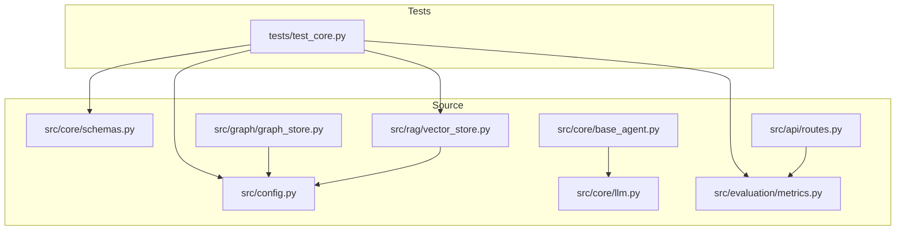

**Diagram sources**
- [test_core.py:1-123](file://tests/test_core.py#L1-L123)
- [config.py:21-81](file://src/config.py#L21-L81)
- [schemas.py:15-168](file://src/core/schemas.py#L15-L168)
- [llm.py:15-103](file://src/core/llm.py#L15-L103)
- [base_agent.py:19-100](file://src/core/base_agent.py#L19-L100)
- [graph_store.py:15-303](file://src/graph/graph_store.py#L15-L303)
- [vector_store.py:16-192](file://src/rag/vector_store.py#L16-L192)
- [metrics.py:19-255](file://src/evaluation/metrics.py#L19-L255)
- [routes.py:341-347](file://src/api/routes.py#L341-L347)

**Section sources**
- [test_core.py:1-123](file://tests/test_core.py#L1-L123)
- [README.md:81-126](file://README.md#L81-L126)

## Core Components
- Test discovery and organization:
  - Tests use pytest conventions with classes grouping related tests and methods asserting behavior.
  - Module-level imports demonstrate importing source modules within tests to avoid global side effects.
- Configuration and settings:
  - Centralized Settings class loads environment variables and provides defaults, enabling isolated test runs without real credentials.
- Data models:
  - Pydantic schemas define strict contracts for queries, evidence, claims, reports, and evaluation results; tests validate default values and field behaviors.
- Evaluation metrics:
  - Deterministic functions compute retrieval metrics and hallucination rates; tests assert expected outputs for known inputs.
- Document processing:
  - Tests verify chunking behavior and document loading using temporary paths provided by pytest fixtures.

**Section sources**
- [test_core.py:12-123](file://tests/test_core.py#L12-L123)
- [config.py:21-81](file://src/config.py#L21-L81)
- [schemas.py:45-168](file://src/core/schemas.py#L45-L168)
- [metrics.py:19-134](file://src/evaluation/metrics.py#L19-L134)

## Architecture Overview
The testing architecture aligns with a layered approach:
- Unit tests target pure functions and small components (e.g., metrics, chunking).
- Integration tests would exercise component interactions (e.g., VectorStore with embeddings, GraphStore with entities).
- End-to-end tests would run full pipelines via API endpoints or CLI commands.

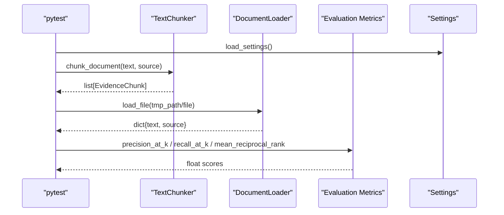

**Diagram sources**
- [test_core.py:54-123](file://tests/test_core.py#L54-L123)
- [metrics.py:19-44](file://src/evaluation/metrics.py#L19-L44)
- [config.py:78-81](file://src/config.py#L78-L81)

## Detailed Component Analysis

### Pydantic Schemas Validation
- Purpose: Ensure data contracts are enforced and defaults are correct across the system.
- Coverage: ResearchQuery, EvidenceChunk, Claim, ResearchReport, and enums like ExperimentType and ClaimVerdict.
- Patterns: Instantiate models with minimal fields and assert defaults; validate type safety and constraints.

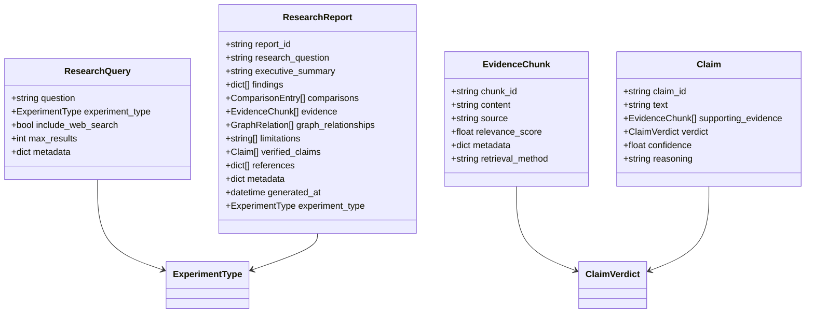

**Diagram sources**
- [schemas.py:45-168](file://src/core/schemas.py#L45-L168)

**Section sources**
- [test_core.py:12-52](file://tests/test_core.py#L12-L52)
- [schemas.py:15-168](file://src/core/schemas.py#L15-L168)

### Text Chunking
- Purpose: Validate that documents are split into chunks with correct attributes and handling of edge cases.
- Coverage: Basic chunking produces at least one chunk; empty input yields no chunks; source propagation is asserted.

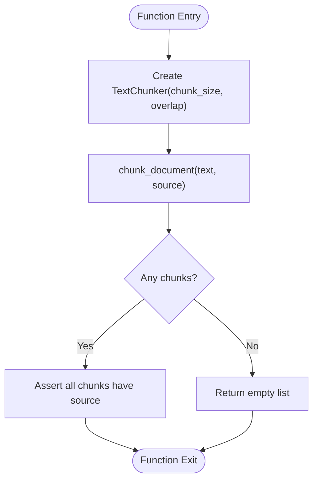

**Diagram sources**
- [test_core.py:54-70](file://tests/test_core.py#L54-L70)

**Section sources**
- [test_core.py:54-70](file://tests/test_core.py#L54-L70)

### Evaluation Metrics
- Purpose: Verify deterministic computation of retrieval and hallucination metrics.
- Coverage: Precision@K, Recall@K, Mean Reciprocal Rank, Hallucination Rate.
- Patterns: Provide known inputs and assert exact expected outputs; ensure boundary conditions return sensible defaults.

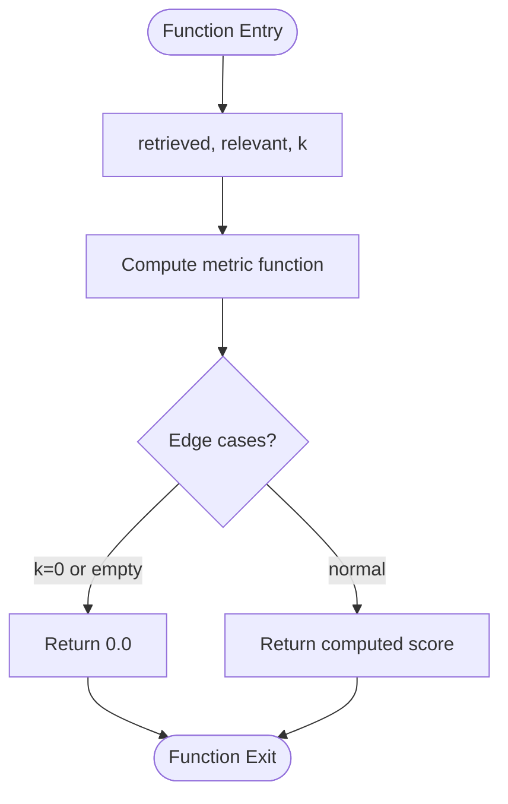

**Diagram sources**
- [metrics.py:19-44](file://src/evaluation/metrics.py#L19-L44)
- [metrics.py:126-134](file://src/evaluation/metrics.py#L126-L134)

**Section sources**
- [test_core.py:72-102](file://tests/test_core.py#L72-L102)
- [metrics.py:19-134](file://src/evaluation/metrics.py#L19-L134)

### Document Loading
- Purpose: Confirm file and directory ingestion behavior using temporary directories.
- Coverage: Load single text file and extract text/source; load multiple files from a directory and assert count.

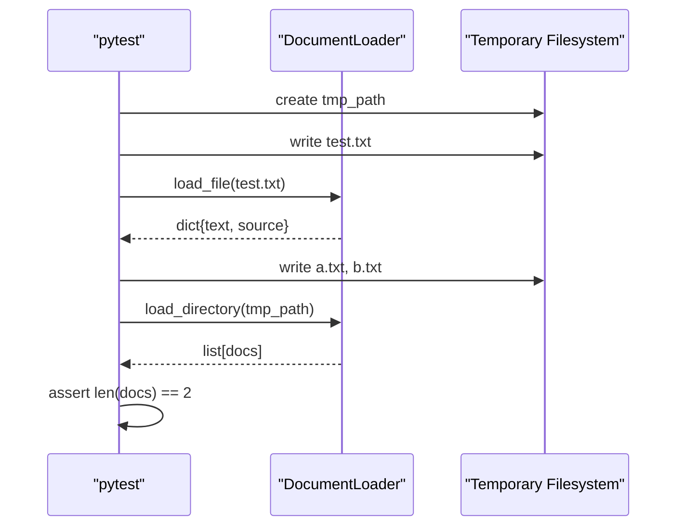

**Diagram sources**
- [test_core.py:104-123](file://tests/test_core.py#L104-L123)

**Section sources**
- [test_core.py:104-123](file://tests/test_core.py#L104-L123)

### LLM Abstraction and Agent Base
- Purpose: Understand how to mock LLM calls and agent behavior in tests.
- Key elements:
  - LLMClient abstracts provider-specific clients and exposes generate and token counting.
  - BaseAgent encapsulates LLM usage, message creation, and execution logging.
- Testing implications:
  - Mock LLMClient.generate to return deterministic responses.
  - Use BaseAgent.create_message to construct messages for agent tests.
  - Inspect execution_log for latency and token usage assertions.

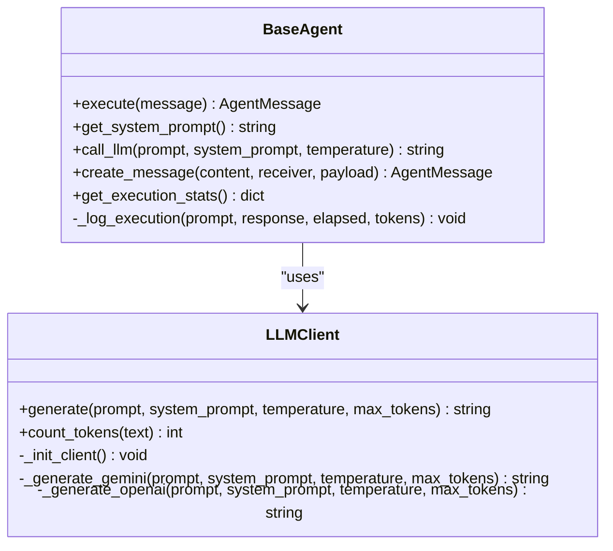

**Diagram sources**
- [llm.py:15-103](file://src/core/llm.py#L15-L103)
- [base_agent.py:19-100](file://src/core/base_agent.py#L19-L100)

**Section sources**
- [llm.py:15-103](file://src/core/llm.py#L15-L103)
- [base_agent.py:19-100](file://src/core/base_agent.py#L19-L100)

### Knowledge Graph Store
- Purpose: Provide a pluggable backend (Neo4j vs NetworkX) for graph operations; enable testing without external services.
- Key behaviors:
  - Auto-fallback to in-memory NetworkX if Neo4j is unavailable.
  - Methods for adding entities/relationships, querying context, counting, clearing, and closing connections.
- Testing implications:
  - Initialize with use_neo4j=False to isolate tests from external databases.
  - Use clear() between tests to reset state.
  - Assert counts and query results deterministically.

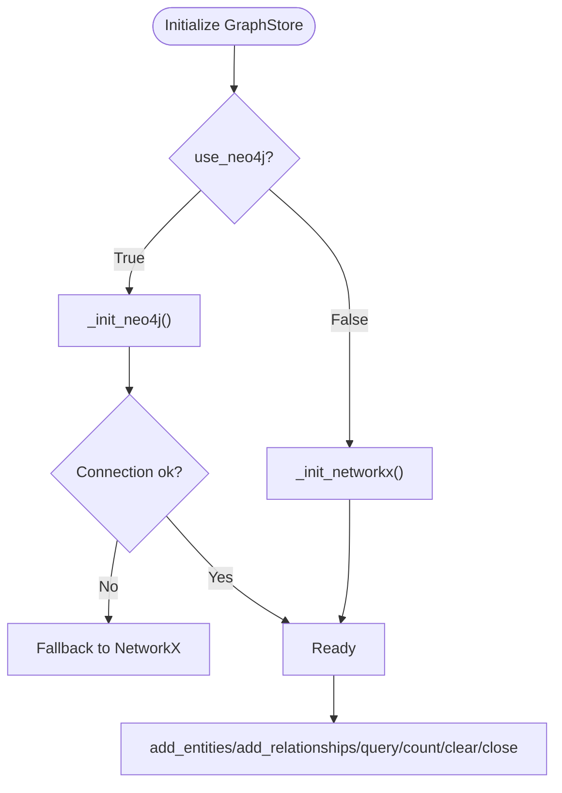

**Diagram sources**
- [graph_store.py:15-138](file://src/graph/graph_store.py#L15-L138)

**Section sources**
- [graph_store.py:15-303](file://src/graph/graph_store.py#L15-L303)

### Vector Store
- Purpose: Abstract ChromaDB and FAISS backends for embedding storage and similarity search.
- Key behaviors:
  - Initialization selects backend based on settings.
  - add_documents supports both backends; search returns structured results with scores and metadata.
  - clear resets state for isolation.
- Testing implications:
  - Prefer FAISS mode for fast, deterministic in-memory tests.
  - Provide explicit query embeddings when using FAISS.
  - Assert counts and result structures after add/search.

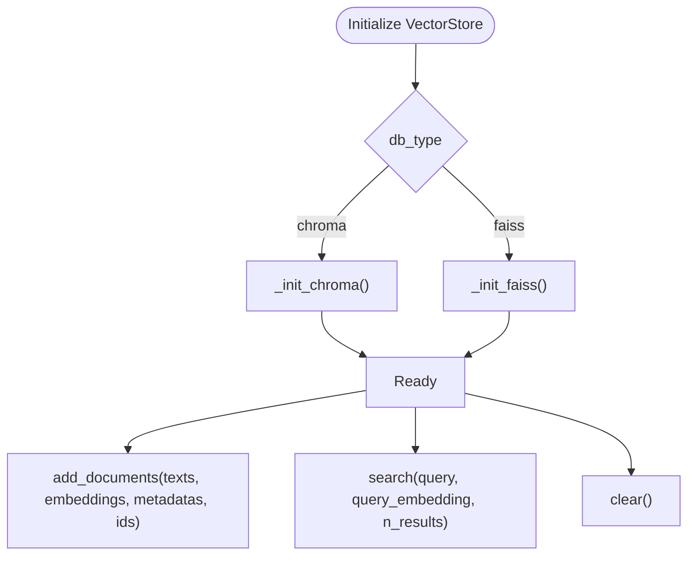

**Diagram sources**
- [vector_store.py:16-192](file://src/rag/vector_store.py#L16-L192)

**Section sources**
- [vector_store.py:16-192](file://src/rag/vector_store.py#L16-L192)

### Evaluation Runner and API Integration
- Purpose: Orchestrate benchmark experiments and expose an endpoint to run evaluations.
- Key behaviors:
  - EvaluationRunner iterates over experiment types and collects metrics; saves JSON results.
  - API route triggers evaluation and returns results.
- Testing implications:
  - Mock LLM client in EvaluationRunner to avoid external calls.
  - Assert saved results structure and metrics keys.
  - Use temporary directories for results during tests.

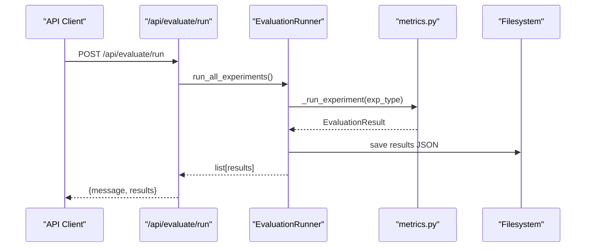

**Diagram sources**
- [routes.py:341-347](file://src/api/routes.py#L341-L347)
- [metrics.py:139-224](file://src/evaluation/metrics.py#L139-L224)

**Section sources**
- [routes.py:341-347](file://src/api/routes.py#L341-L347)
- [metrics.py:139-224](file://src/evaluation/metrics.py#L139-L224)

## Dependency Analysis
External dependencies influence test design:
- LLM providers (Gemini/OpenAI): mocked via LLMClient to avoid network calls and costs.
- Vector databases (ChromaDB/FAISS): prefer FAISS for deterministic, in-memory tests; clear state between tests.
- Knowledge graph (Neo4j/NetworkX): use NetworkX fallback for isolated tests; clear graph between runs.
- Configuration: Settings loaded from environment; tests can override via environment variables or patch get_settings.

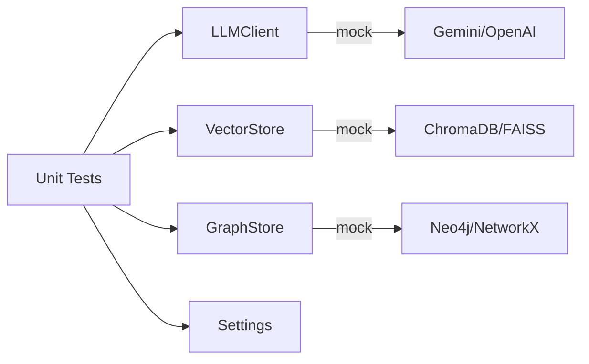

**Diagram sources**
- [llm.py:15-103](file://src/core/llm.py#L15-L103)
- [vector_store.py:16-192](file://src/rag/vector_store.py#L16-L192)
- [graph_store.py:15-303](file://src/graph/graph_store.py#L15-L303)
- [config.py:21-81](file://src/config.py#L21-L81)

**Section sources**
- [requirements.txt:1-60](file://requirements.txt#L1-L60)

## Performance Considerations
- Prefer in-memory backends (FAISS, NetworkX) for fast, deterministic unit tests.
- Minimize I/O by using pytest tmp_path fixtures for file operations.
- Avoid heavy model initialization in tests; mock LLMClient.generate to return lightweight strings.
- Cache settings via lru_cache; reset or reload settings in test setup if necessary.
- Limit search sizes (n_results) and hop depths in graph queries to keep tests quick.

## Troubleshooting Guide
Common issues and resolutions:
- Missing environment variables:
  - Ensure .env exists or provide required keys; tests rely on Settings defaults where possible.
- External service connectivity:
  - For GraphStore, if Neo4j is unreachable, it falls back to NetworkX; verify logs and assert fallback behavior.
- Vector store initialization failures:
  - ChromaDB init may fail; check logs and consider switching to FAISS for tests.
- LLM provider errors:
  - Mock LLMClient.generate to bypass network calls; assert error handling paths in metrics functions.

**Section sources**
- [graph_store.py:29-47](file://src/graph/graph_store.py#L29-L47)
- [vector_store.py:33-58](file://src/rag/vector_store.py#L33-L58)
- [metrics.py:47-102](file://src/evaluation/metrics.py#L47-L102)

## Conclusion
The testing strategy emphasizes deterministic, isolated unit tests for core logic, leveraging pytest fixtures and configuration centralization. The codebase provides clear extension points to expand coverage into integration and end-to-end scenarios while maintaining reliability through mocking and fallback mechanisms. By adhering to the outlined practices—using in-memory backends, mocking external services, and organizing tests by component—you can build a robust, scalable test suite that ensures system correctness and performance.

## Appendices

### Test Pyramid and Quality Gates
- Unit tests:
  - Validate pure functions (metrics), schema validation, chunking, and document loading.
- Integration tests:
  - Exercise component interactions (e.g., VectorStore.add_documents + search; GraphStore.add_entities + query).
- End-to-end tests:
  - Run full pipelines via API endpoints or CLI commands; assert final report structure and metrics.
- Quality gates:
  - All unit tests must pass before merging.
  - Integration tests should be gated in CI with mocked external services.
  - E2E tests optional for nightly runs with real services disabled by default.

### Mocking Strategies
- LLM providers:
  - Patch LLMClient.generate to return controlled responses; assert token counting and latency logging.
- Vector databases:
  - Use FAISS mode; clear index between tests; assert counts and top-k results.
- Knowledge graph:
  - Use NetworkX mode; clear graph between tests; assert entity/relationship counts and query outputs.

### Test Data Management
- Fixtures:
  - Use pytest tmp_path for temporary files and directories.
- Isolation:
  - Reset state in setUp/tearDown or use autouse fixtures for GraphStore.clear and VectorStore.clear.
- Determinism:
  - Provide fixed inputs and assert exact outputs for metrics and chunking.

### Continuous Integration Setup
- Execution workflow:
  - Install dependencies from requirements.txt.
  - Run pytest with verbose output; collect XML reports for analysis.
- Reporting:
  - Generate JUnit XML and HTML reports; upload artifacts for review.
- Environment:
  - Provide minimal .env with defaults; disable external services via flags or mocks.

**Section sources**
- [requirements.txt:1-60](file://requirements.txt#L1-L60)
- [test_core.py:1-123](file://tests/test_core.py#L1-L123)
- [config.py:21-81](file://src/config.py#L21-L81)
- [README.md:35-73](file://README.md#L35-L73)