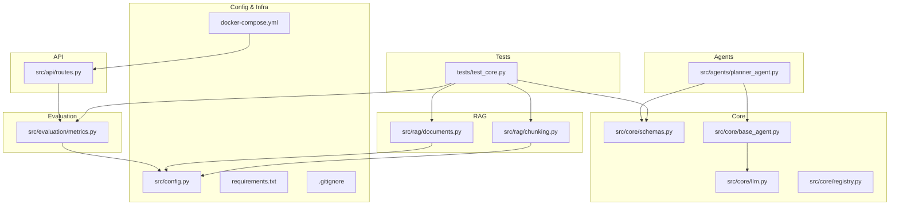
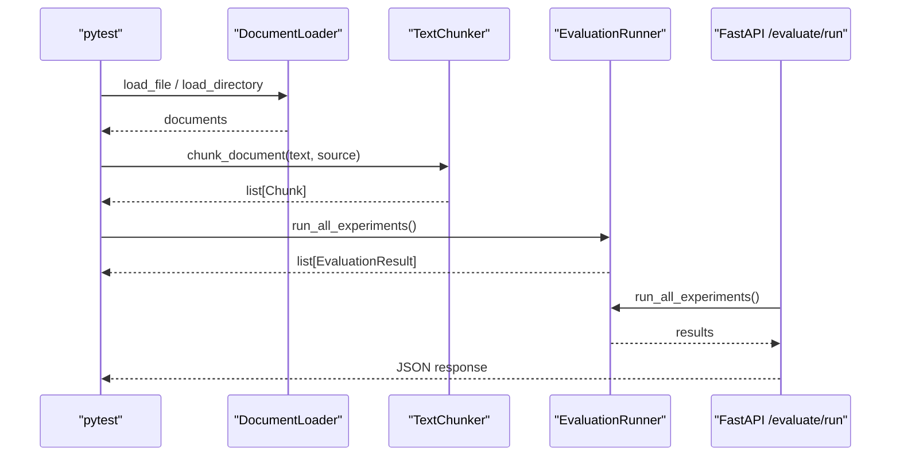
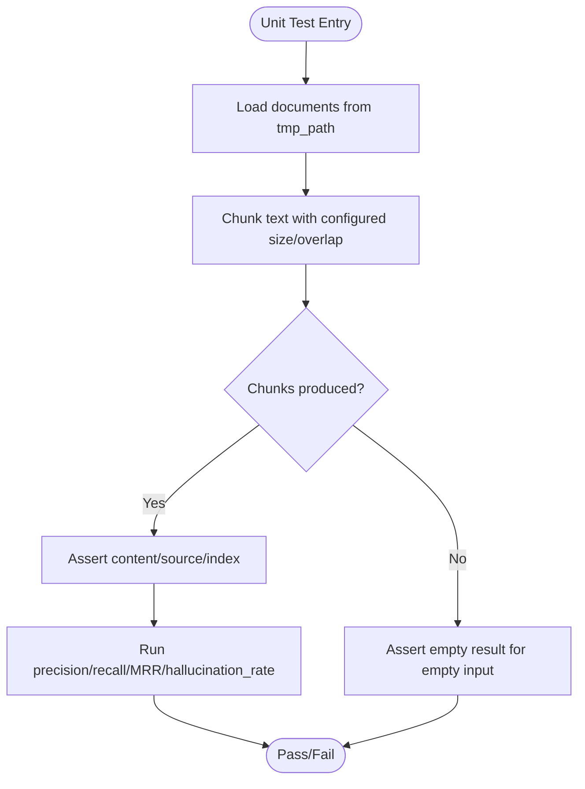
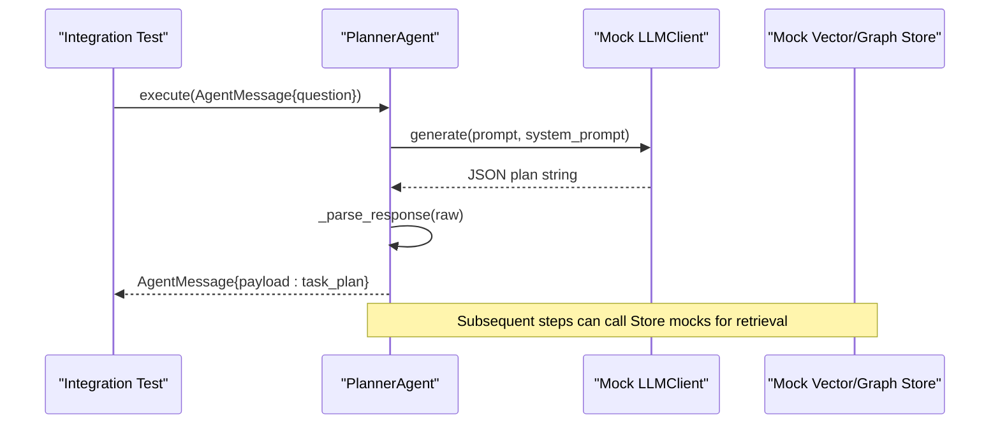
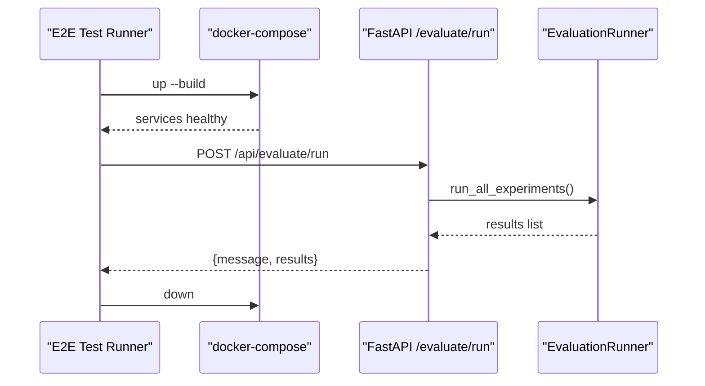
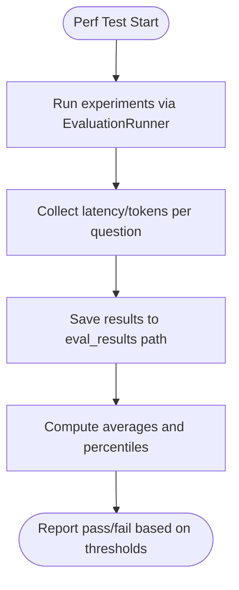
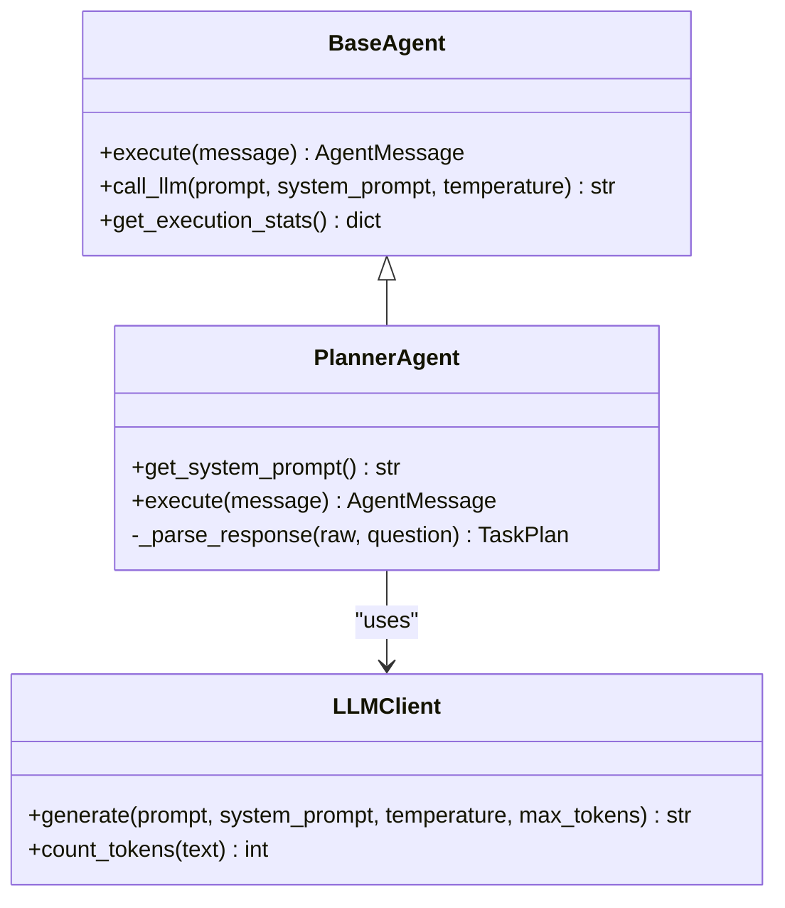
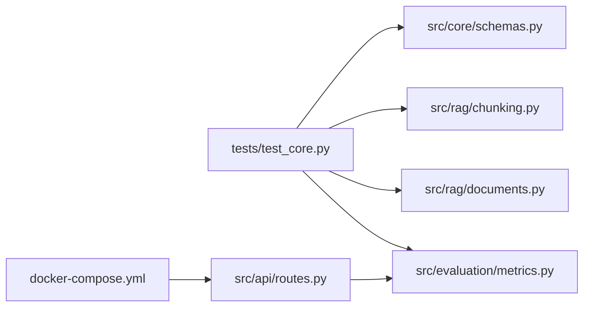

# Testing and Quality Assurance

<cite>
**Referenced Files in This Document**
- [README.md](file://README.md)
- [requirements.txt](file://requirements.txt)
- [docker-compose.yml](file://docker-compose.yml)
- [.gitignore](file://.gitignore)
- [tests/test_core.py](file://tests/test_core.py)
- [src/core/schemas.py](file://src/core/schemas.py)
- [src/core/base_agent.py](file://src/core/base_agent.py)
- [src/core/llm.py](file://src/core/llm.py)
- [src/core/registry.py](file://src/core/registry.py)
- [src/agents/planner_agent.py](file://src/agents/planner_agent.py)
- [src/rag/chunking.py](file://src/rag/chunking.py)
- [src/rag/documents.py](file://src/rag/documents.py)
- [src/evaluation/metrics.py](file://src/evaluation/metrics.py)
- [src/config.py](file://src/config.py)
- [src/api/routes.py](file://src/api/routes.py)
</cite>

## Table of Contents
1. [Introduction](#introduction)
2. [Project Structure](#project-structure)
3. [Core Components](#core-components)
4. [Architecture Overview](#architecture-overview)
5. [Detailed Component Analysis](#detailed-component-analysis)
6. [Dependency Analysis](#dependency-analysis)
7. [Performance Considerations](#performance-considerations)
8. [Troubleshooting Guide](#troubleshooting-guide)
9. [Conclusion](#conclusion)
10. [Appendices](#appendices)

## Introduction
This document explains the testing strategy and quality assurance practices for the Graph RAG + Multi-Agent Research System. It covers unit tests, integration tests, end-to-end tests, performance tests, test infrastructure (data management, mocking, CI), AI-specific testing (prompt validation, model output checks, hallucination detection), guidelines for writing effective tests, examples of test cases, code quality tools, static analysis, linting standards, code review processes, debugging techniques, logging strategies, and observability practices.

## Project Structure
The repository organizes code by feature layers: core abstractions, agents, retrieval pipelines, graph components, API routes, evaluation metrics, and a small existing test suite under tests/. Configuration is centralized, and external services are orchestrated via Docker Compose.

**Diagram sources**
- [tests/test_core.py:1-123](file://tests/test_core.py#L1-L123)
- [src/core/schemas.py:1-168](file://src/core/schemas.py#L1-L168)
- [src/core/base_agent.py:1-100](file://src/core/base_agent.py#L1-L100)
- [src/core/llm.py:1-103](file://src/core/llm.py#L1-L103)
- [src/core/registry.py:1-50](file://src/core/registry.py#L1-L50)
- [src/agents/planner_agent.py:1-128](file://src/agents/planner_agent.py#L1-L128)
- [src/rag/chunking.py:1-111](file://src/rag/chunking.py#L1-L111)
- [src/rag/documents.py:1-103](file://src/rag/documents.py#L1-L103)
- [src/evaluation/metrics.py:1-255](file://src/evaluation/metrics.py#L1-L255)
- [src/api/routes.py:333-353](file://src/api/routes.py#L333-L353)
- [src/config.py:56-81](file://src/config.py#L56-L81)
- [docker-compose.yml:1-56](file://docker-compose.yml#L1-L56)
- [requirements.txt:1-60](file://requirements.txt#L1-L60)
- [.gitignore:1-42](file://.gitignore#L1-L42)

**Section sources**
- [README.md:81-126](file://README.md#L81-L126)
- [docker-compose.yml:1-56](file://docker-compose.yml#L1-L56)

## Core Components
- Schemas: Central Pydantic models define queries, evidence, claims, reports, and evaluation results used across agents and tests.
- Base Agent: Abstract base with execution logging, message creation, and LLM invocation helpers.
- LLM Client: Unified interface to Gemini/OpenAI with token counting and provider selection.
- Planner Agent: Decomposes research questions into sub-questions and required agents; parses structured JSON responses with fallbacks.
- Chunker: Sentence-aware chunking with configurable size and overlap.
- Document Loader: Loads PDF/DOCX/TXT/MD/CSV with robust fallbacks and error handling.
- Evaluation Metrics: Retrieval metrics (Precision@K, Recall@K, MRR), answer quality (factual correctness, faithfulness), hallucination rate, and benchmark runner.
- API Routes: Endpoints including an evaluation runner that invokes the benchmark suite.

**Section sources**
- [src/core/schemas.py:15-168](file://src/core/schemas.py#L15-L168)
- [src/core/base_agent.py:19-100](file://src/core/base_agent.py#L19-L100)
- [src/core/llm.py:15-103](file://src/core/llm.py#L15-L103)
- [src/agents/planner_agent.py:23-128](file://src/agents/planner_agent.py#L23-L128)
- [src/rag/chunking.py:17-111](file://src/rag/chunking.py#L17-L111)
- [src/rag/documents.py:15-103](file://src/rag/documents.py#L15-L103)
- [src/evaluation/metrics.py:19-135](file://src/evaluation/metrics.py#L19-L135)
- [src/api/routes.py:341-347](file://src/api/routes.py#L341-L347)

## Architecture Overview
Testing spans multiple layers:
- Unit tests validate schemas, chunking, document loading, and metric functions.
- Integration tests should verify agent interactions and retrieval flows using mocked LLMs and stores.
- End-to-end tests exercise the API endpoints and orchestration via Docker Compose.
- Performance tests measure latency, token usage, and throughput during evaluation runs.

**Diagram sources**
- [tests/test_core.py:107-123](file://tests/test_core.py#L107-L123)
- [src/rag/documents.py:20-61](file://src/rag/documents.py#L20-L61)
- [src/rag/chunking.py:41-104](file://src/rag/chunking.py#L41-L104)
- [src/evaluation/metrics.py:165-177](file://src/evaluation/metrics.py#L165-L177)
- [src/api/routes.py:341-347](file://src/api/routes.py#L341-L347)

## Detailed Component Analysis

### Unit Tests: Schemas, Chunking, Metrics, Documents
- Schema validation ensures type safety and default behaviors for queries, evidence chunks, claims, and reports.
- Chunking tests confirm non-empty outputs, correct source propagation, and empty input handling.
- Metric tests assert deterministic behavior for Precision@K, Recall@K, MRR, and Hallucination Rate.
- Document loader tests use temporary directories to validate file reading and directory scanning.

**Diagram sources**
- [tests/test_core.py:54-102](file://tests/test_core.py#L54-L102)
- [tests/test_core.py:107-123](file://tests/test_core.py#L107-L123)
- [src/rag/chunking.py:41-104](file://src/rag/chunking.py#L41-L104)
- [src/evaluation/metrics.py:21-135](file://src/evaluation/metrics.py#L21-L135)

**Section sources**
- [tests/test_core.py:12-52](file://tests/test_core.py#L12-L52)
- [tests/test_core.py:54-102](file://tests/test_core.py#L54-L102)
- [tests/test_core.py:107-123](file://tests/test_core.py#L107-L123)

### Integration Tests: Agent Interactions and Retrieval
- Use the BaseAgent’s call_llm helper to inject a mock LLMClient that returns deterministic JSON or strings.
- Validate PlannerAgent’s execute method produces a TaskPlan with expected fields and fallback behavior when parsing fails.
- Verify retrieval paths by mocking vector/graph/web retrievers and asserting EvidenceChunk payloads.

**Diagram sources**
- [src/agents/planner_agent.py:65-128](file://src/agents/planner_agent.py#L65-L128)
- [src/core/base_agent.py:42-59](file://src/core/base_agent.py#L42-L59)
- [src/core/llm.py:40-87](file://src/core/llm.py#L40-L87)

**Section sources**
- [src/agents/planner_agent.py:56-128](file://src/agents/planner_agent.py#L56-L128)
- [src/core/base_agent.py:19-100](file://src/core/base_agent.py#L19-L100)

### End-to-End Tests: API and Orchestration
- Spin up services with docker-compose.yml to provide Neo4j and backend dependencies.
- Exercise the /api/evaluate/run endpoint to trigger the full benchmark suite and assert JSON structure and status codes.
- Validate health/status endpoints to ensure service readiness before running E2E flows.

**Diagram sources**
- [docker-compose.yml:1-56](file://docker-compose.yml#L1-L56)
- [src/api/routes.py:341-347](file://src/api/routes.py#L341-L347)
- [src/evaluation/metrics.py:165-177](file://src/evaluation/metrics.py#L165-L177)

**Section sources**
- [docker-compose.yml:1-56](file://docker-compose.yml#L1-L56)
- [src/api/routes.py:341-347](file://src/api/routes.py#L341-L347)

### Performance Tests: Scalability and Latency
- Use EvaluationRunner to measure latency, token usage, and throughput across experiment types.
- Add assertions on acceptable bounds for latency and token consumption under load.
- Record metrics to disk via the built-in save mechanism for trend analysis.

**Diagram sources**
- [src/evaluation/metrics.py:165-224](file://src/evaluation/metrics.py#L165-L224)
- [src/config.py:64-66](file://src/config.py#L64-L66)

**Section sources**
- [src/evaluation/metrics.py:165-224](file://src/evaluation/metrics.py#L165-L224)
- [src/config.py:64-66](file://src/config.py#L64-L66)

### AI-Specific Testing: Prompts, Outputs, Hallucinations
- Prompt testing: Validate planner prompts and system instructions produce expected JSON structures; include negative cases where LLM returns malformed JSON to exercise fallback parsing.
- Model output validation: Assert that generated answers meet schema constraints and contain required fields; check confidence and verdict values for claims.
- Hallucination detection verification: Use hallucination_rate and faithfulness_score to quantify unsupported claims and alignment with evidence; add tests for edge cases like empty evidence or extreme scores.

**Diagram sources**
- [src/core/base_agent.py:19-100](file://src/core/base_agent.py#L19-L100)
- [src/agents/planner_agent.py:56-128](file://src/agents/planner_agent.py#L56-L128)
- [src/core/llm.py:15-103](file://src/core/llm.py#L15-L103)

**Section sources**
- [src/agents/planner_agent.py:23-128](file://src/agents/planner_agent.py#L23-L128)
- [src/core/base_agent.py:42-99](file://src/core/base_agent.py#L42-L99)
- [src/evaluation/metrics.py:70-135](file://src/evaluation/metrics.py#L70-L135)

### Guidelines for Writing Effective Tests
- Custom Agents:
  - Mock LLMClient to return deterministic responses; assert parsed TaskPlan fields and fallback behavior.
  - Use BaseAgent.create_message to construct inputs and verify outgoing messages’ payload structure.
- Retrieval Strategies:
  - Mock vector/graph/web retrievers; assert EvidenceChunk metadata and relevance scores.
  - Validate chunking parameters (size/overlap) impact output counts and boundaries.
- Evaluation Metrics:
  - Provide known retrieved/relevant sets to assert deterministic metric outputs.
  - Include edge cases: empty lists, zero k, no relevant items.

**Section sources**
- [src/core/base_agent.py:74-99](file://src/core/base_agent.py#L74-L99)
- [src/rag/chunking.py:32-104](file://src/rag/chunking.py#L32-L104)
- [src/evaluation/metrics.py:21-135](file://src/evaluation/metrics.py#L21-L135)

### Examples of Test Cases
- Common scenarios:
  - Valid query ingestion and report generation pipeline.
  - Successful chunking of multi-sentence documents.
  - Correct computation of Precision@K, Recall@K, MRR.
- Edge cases:
  - Empty text input to chunker yields no chunks.
  - Unsupported file extension raises ValueError.
  - Malformed LLM JSON triggers fallback plan creation.
- Failure modes:
  - Missing environment variables for LLM provider raise configuration errors.
  - Network failures in web search or vector store calls handled gracefully with logs and safe defaults.

**Section sources**
- [tests/test_core.py:54-102](file://tests/test_core.py#L54-L102)
- [src/rag/documents.py:20-35](file://src/rag/documents.py#L20-L35)
- [src/agents/planner_agent.py:97-128](file://src/agents/planner_agent.py#L97-L128)
- [src/core/llm.py:25-38](file://src/core/llm.py#L25-L38)

## Dependency Analysis
The test suite depends on core schemas, chunking, document loading, and evaluation metrics. The API exposes an evaluation endpoint that orchestrates the benchmark runner. External services (Neo4j) are provided via Docker Compose.

**Diagram sources**
- [tests/test_core.py:1-123](file://tests/test_core.py#L1-L123)
- [src/core/schemas.py:1-168](file://src/core/schemas.py#L1-L168)
- [src/rag/chunking.py:1-111](file://src/rag/chunking.py#L1-L111)
- [src/rag/documents.py:1-103](file://src/rag/documents.py#L1-L103)
- [src/evaluation/metrics.py:1-255](file://src/evaluation/metrics.py#L1-L255)
- [src/api/routes.py:341-347](file://src/api/routes.py#L341-L347)
- [docker-compose.yml:1-56](file://docker-compose.yml#L1-L56)

**Section sources**
- [tests/test_core.py:1-123](file://tests/test_core.py#L1-L123)
- [src/api/routes.py:341-347](file://src/api/routes.py#L341-L347)
- [docker-compose.yml:1-56](file://docker-compose.yml#L1-L56)

## Performance Considerations
- Use EvaluationRunner to capture latency and token usage; set thresholds in tests to detect regressions.
- Prefer mocked LLMs in unit/integration tests to avoid network variability and cost.
- Cache settings and reuse fixtures to reduce setup overhead.
- For E2E/perf tests, run against local containers and limit dataset sizes to keep suites fast.

[No sources needed since this section provides general guidance]

## Troubleshooting Guide
- Logging:
  - All components log via loguru; inspect logs for chunking, document loading, and evaluation steps.
  - BaseAgent records execution stats including latency and token counts for each LLM call.
- Error Handling:
  - DocumentLoader raises FileNotFoundError and ValueError for invalid inputs; tests should assert these.
  - PlannerAgent falls back to a single-task plan if LLM JSON parsing fails; verify fallback behavior.
  - LLMClient raises ValueError for unsupported providers; ensure environment variables are set correctly.
- Observability:
  - EvaluationRunner saves results to a configured path; use these files to diagnose metric trends.
  - Docker Compose includes healthchecks for Neo4j; rely on them to ensure service readiness.

**Section sources**
- [src/core/base_agent.py:61-99](file://src/core/base_agent.py#L61-L99)
- [src/rag/documents.py:20-61](file://src/rag/documents.py#L20-L61)
- [src/agents/planner_agent.py:97-128](file://src/agents/planner_agent.py#L97-L128)
- [src/core/llm.py:25-38](file://src/core/llm.py#L25-L38)
- [src/evaluation/metrics.py:217-224](file://src/evaluation/metrics.py#L217-L224)
- [docker-compose.yml:16-20](file://docker-compose.yml#L16-L20)

## Conclusion
The system provides a solid foundation for testing across unit, integration, end-to-end, and performance dimensions. Existing tests cover schemas, chunking, metrics, and document loading. To strengthen QA:
- Expand integration tests with mocked LLMs and retrievers.
- Add E2E tests leveraging Docker Compose and the /evaluate/run endpoint.
- Implement performance benchmarks with threshold-based assertions.
- Standardize prompt testing and hallucination checks using the provided metrics.
- Adopt consistent linting, static analysis, and code review practices to maintain quality.

[No sources needed since this section summarizes without analyzing specific files]

## Appendices

### Test Infrastructure and Data Management
- Test data: Use temporary directories (tmp_path) for document loading tests; keep datasets minimal for speed.
- Mocking strategies:
  - Replace LLMClient.generate with deterministic responses for stable tests.
  - Mock vector/graph/web retrievers to isolate logic and control evidence payloads.
- Continuous Integration:
  - Define a CI job to install dependencies, run pytest, and optionally start Docker Compose for E2E tests.
  - Cache dependencies and indexes to accelerate builds.

**Section sources**
- [tests/test_core.py:107-123](file://tests/test_core.py#L107-L123)
- [docker-compose.yml:1-56](file://docker-compose.yml#L1-L56)
- [requirements.txt:1-60](file://requirements.txt#L1-L60)

### Code Quality Tools and Standards
- Dependencies include rich and loguru for better console output and logging; consider adding flake8, black, mypy, and pre-commit hooks for linting, formatting, and type checking.
- Static analysis: Integrate mypy to enforce type safety across schemas and agent interfaces.
- Linting standards: Enforce consistent style and import ordering; configure rules to match project conventions.
- Code review: Require PR reviews focusing on prompt changes, metric definitions, and agent behavior modifications.

**Section sources**
- [requirements.txt:51-56](file://requirements.txt#L51-L56)
- [src/core/schemas.py:1-168](file://src/core/schemas.py#L1-L168)

### Debugging Techniques and Observability
- Enable detailed logging in tests by configuring loguru handlers to capture debug/info levels.
- Use BaseAgent.get_execution_stats to aggregate latency and token usage per agent run.
- Persist evaluation results to disk for post-run analysis; compare across runs to detect regressions.
- Leverage Docker Compose healthchecks to ensure services are ready before executing tests.

**Section sources**
- [src/core/base_agent.py:88-99](file://src/core/base_agent.py#L88-L99)
- [src/evaluation/metrics.py:217-224](file://src/evaluation/metrics.py#L217-L224)
- [docker-compose.yml:16-20](file://docker-compose.yml#L16-L20)