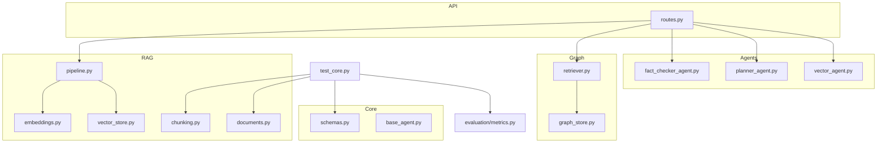
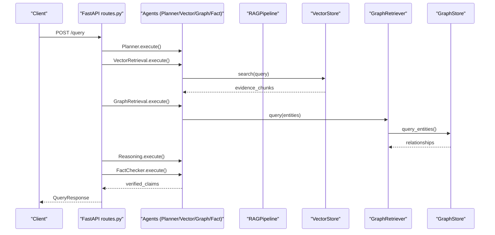
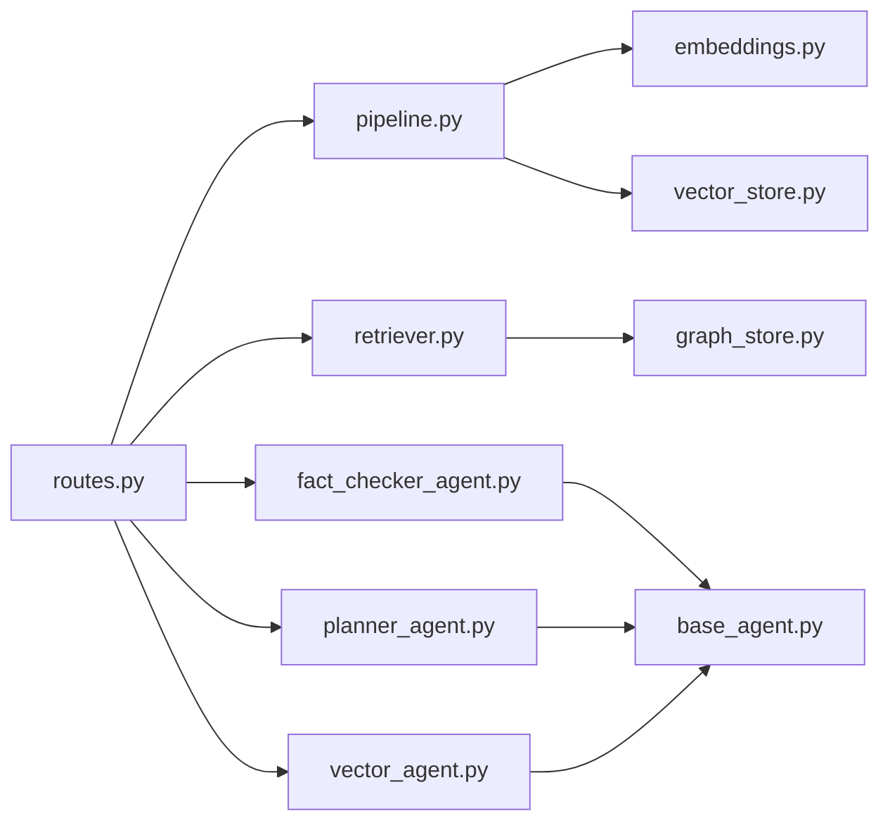

# Unit and Integration Tests

<cite>
**Referenced Files in This Document**
- [test_core.py](file://tests/test_core.py)
- [schemas.py](file://src/core/schemas.py)
- [chunking.py](file://src/rag/chunking.py)
- [documents.py](file://src/rag/documents.py)
- [metrics.py](file://src/evaluation/metrics.py)
- [pipeline.py](file://src/rag/pipeline.py)
- [vector_store.py](file://src/rag/vector_store.py)
- [embeddings.py](file://src/rag/embeddings.py)
- [retriever.py](file://src/graph/retriever.py)
- [graph_store.py](file://src/graph/graph_store.py)
- [base_agent.py](file://src/core/base_agent.py)
- [fact_checker_agent.py](file://src/agents/fact_checker_agent.py)
- [planner_agent.py](file://src/agents/planner_agent.py)
- [vector_agent.py](file://src/agents/vector_agent.py)
- [routes.py](file://src/api/routes.py)
</cite>

## Table of Contents
1. Introduction
2. Project Structure
3. Core Components
4. Architecture Overview
5. Detailed Component Analysis
6. Dependency Analysis
7. Performance Considerations
8. Troubleshooting Guide
9. Conclusion

## Introduction
This document provides comprehensive guidance for unit and integration testing across the Graph RAG + Multi-Agent Research System. It covers:
- Unit tests for Pydantic schemas, text chunking, document loading, and evaluation metrics
- Integration tests for agent interactions, RAG pipeline execution, and knowledge graph operations
- Edge-case scenarios including empty inputs, malformed documents, and API failures
- Testing asynchronous operations, error handling, and exception scenarios
- Guidance for testing AI-specific components such as embeddings, similarity scoring, and claim verification
- Performance and load testing strategies for production readiness

## Project Structure
The repository organizes code by functional areas: core schemas and agents, retrieval and vector/graph stores, evaluation metrics, and an API layer that orchestrates end-to-end workflows. Tests currently exist for core functionality and can be extended to cover additional modules.

**Diagram sources**
- [test_core.py:12-123](file://tests/test_core.py#L12-L123)
- [schemas.py:15-168](file://src/core/schemas.py#L15-L168)
- [chunking.py:17-111](file://src/rag/chunking.py#L17-L111)
- [documents.py:15-103](file://src/rag/documents.py#L15-L103)
- [metrics.py:19-255](file://src/evaluation/metrics.py#L19-L255)
- [pipeline.py:19-102](file://src/rag/pipeline.py#L19-L102)
- [vector_store.py:16-192](file://src/rag/vector_store.py#L16-L192)
- [embeddings.py:16-58](file://src/rag/embeddings.py#L16-L58)
- [retriever.py:19-131](file://src/graph/retriever.py#L19-L131)
- [graph_store.py:15-303](file://src/graph/graph_store.py#L15-L303)
- [base_agent.py:19-100](file://src/core/base_agent.py#L19-L100)
- [fact_checker_agent.py:54-163](file://src/agents/fact_checker_agent.py#L54-L163)
- [planner_agent.py:56-128](file://src/agents/planner_agent.py#L56-L128)
- [vector_agent.py:34-92](file://src/agents/vector_agent.py#L34-L92)
- [routes.py:116-354](file://src/api/routes.py#L116-L354)

**Section sources**
- [test_core.py:12-123](file://tests/test_core.py#L12-L123)
- [routes.py:116-354](file://src/api/routes.py#L116-L354)

## Core Components
This section outlines the primary units under test and how they are exercised in the existing test suite.

- Pydantic schema validation
  - Tests verify model instantiation and default values for research queries, evidence chunks, claims, and reports.
  - Focus on enum correctness, required fields, and default behaviors.

- Text chunking
  - Tests ensure non-empty input produces at least one chunk and that source metadata is preserved.
  - Empty string input yields zero chunks.

- Document loading
  - Tests assert successful loading of a single text file and directory scanning for multiple files.
  - Validate returned structure includes text and source.

- Evaluation metrics
  - Tests validate precision@k, recall@k, mean reciprocal rank, and hallucination rate calculations.

**Section sources**
- [test_core.py:12-52](file://tests/test_core.py#L12-L52)
- [test_core.py:54-70](file://tests/test_core.py#L54-L70)
- [test_core.py:104-123](file://tests/test_core.py#L104-L123)
- [test_core.py:72-102](file://tests/test_core.py#L72-L102)
- [schemas.py:45-168](file://src/core/schemas.py#L45-L168)
- [chunking.py:29-111](file://src/rag/chunking.py#L29-L111)
- [documents.py:15-61](file://src/rag/documents.py#L15-L61)
- [metrics.py:21-134](file://src/evaluation/metrics.py#L21-L134)

## Architecture Overview
The system integrates retrieval (vector and graph), multi-agent orchestration, and evaluation. The API routes coordinate ingestion, graph building, querying, and evaluation endpoints.

**Diagram sources**
- [routes.py:188-338](file://src/api/routes.py#L188-L338)
- [pipeline.py:19-102](file://src/rag/pipeline.py#L19-L102)
- [vector_store.py:16-192](file://src/rag/vector_store.py#L16-L192)
- [retriever.py:19-131](file://src/graph/retriever.py#L19-L131)
- [graph_store.py:15-303](file://src/graph/graph_store.py#L15-L303)
- [planner_agent.py:56-128](file://src/agents/planner_agent.py#L56-L128)
- [vector_agent.py:34-92](file://src/agents/vector_agent.py#L34-L92)
- [fact_checker_agent.py:54-163](file://src/agents/fact_checker_agent.py#L54-L163)

## Detailed Component Analysis

### Unit Testing Strategies

#### Pydantic Schemas Validation
- Test model construction with minimal and full payloads
- Validate enums and defaults
- Ensure serialization/deserialization round-trips for report and claim models

Recommended cases:
- Invalid enum values raise validation errors
- Missing required fields raise validation errors
- Optional fields default correctly

**Section sources**
- [schemas.py:45-168](file://src/core/schemas.py#L45-L168)
- [test_core.py:12-52](file://tests/test_core.py#L12-L52)

#### Text Chunking Algorithms
- Verify behavior for normal text, empty strings, and edge punctuation
- Confirm overlap logic preserves sentence boundaries
- Validate chunk metadata (source, indices, character offsets)

Recommended cases:
- Very long sentences exceeding chunk size
- Multiple consecutive delimiters
- Mixed languages or special characters

**Section sources**
- [chunking.py:29-111](file://src/rag/chunking.py#L29-L111)
- [test_core.py:54-70](file://tests/test_core.py#L54-L70)

#### Document Loading Functionality
- Assert supported extensions and error handling for unsupported types
- Validate directory traversal and per-file error isolation
- Check metadata fields like path, extension, and size

Recommended cases:
- Non-existent file raises appropriate error
- Directory contains mixed supported/unsupported files
- Large binary or corrupted files handled gracefully

**Section sources**
- [documents.py:15-61](file://src/rag/documents.py#L15-L61)
- [test_core.py:104-123](file://tests/test_core.py#L104-L123)

#### Evaluation Metrics Calculations
- Validate deterministic outputs for known inputs
- Test boundary conditions (empty sets, k=0)
- Ensure fallback behavior when LLM client is unavailable

Recommended cases:
- Precision/recall with partial overlaps
- MRR where first relevant appears later
- Hallucination rate with various verdict distributions

**Section sources**
- [metrics.py:21-134](file://src/evaluation/metrics.py#L21-L134)
- [test_core.py:72-102](file://tests/test_core.py#L72-L102)

### Integration Testing Strategies

#### Agent Interactions
- End-to-end flow through Planner -> Retrievers -> Reasoning -> Fact Checker -> Report Generator
- Validate message contracts using AgentMessage and schemas
- Mock LLM calls to isolate agent logic from external services

Recommended cases:
- Malformed LLM responses trigger fallback parsing
- Missing vector store returns empty evidence
- Graph store unavailability falls back to in-memory implementation

**Section sources**
- [base_agent.py:19-100](file://src/core/base_agent.py#L19-L100)
- [planner_agent.py:56-128](file://src/agents/planner_agent.py#L56-L128)
- [vector_agent.py:34-92](file://src/agents/vector_agent.py#L34-L92)
- [fact_checker_agent.py:54-163](file://src/agents/fact_checker_agent.py#L54-L163)
- [routes.py:188-338](file://src/api/routes.py#L188-L338)

#### RAG Pipeline Execution
- Ingest directory/file -> chunk -> embed -> index -> query
- Validate counts and indexing results
- Ensure embedding dimensions match vector store expectations

Recommended cases:
- Empty documents produce zero chunks
- Batch embedding handles large lists efficiently
- Search returns expected number of results

**Section sources**
- [pipeline.py:19-102](file://src/rag/pipeline.py#L19-L102)
- [embeddings.py:16-58](file://src/rag/embeddings.py#L16-L58)
- [vector_store.py:16-192](file://src/rag/vector_store.py#L16-L192)

#### Knowledge Graph Operations
- Build graph from documents via retriever
- Query entities with hop depth and relationship filters
- Validate entity deduplication and relationship aggregation

Recommended cases:
- No chunks yield no entities/relationships
- Neo4j fallback to NetworkX when unavailable
- Query limits respected

**Section sources**
- [retriever.py:19-131](file://src/graph/retriever.py#L19-L131)
- [graph_store.py:15-303](file://src/graph/graph_store.py#L15-L303)

### Edge Scenarios and Error Handling

- Empty inputs
  - Chunking returns empty list
  - Document loader handles empty directories
  - Metrics return safe defaults for empty sets

- Malformed documents
  - Unsupported file type raises ValueError
  - PDF loaders fall back between libraries; missing libraries raise ImportError

- API failures
  - Status endpoint checks component health
  - Report retrieval endpoint returns HTTP 404 placeholder

- Asynchronous operations
  - FastAPI endpoints are async; use httpx.AsyncClient for integration tests
  - Timeouts and retries for external dependencies (LLM, DBs)

**Section sources**
- [chunking.py:41-50](file://src/rag/chunking.py#L41-L50)
- [documents.py:20-35](file://src/rag/documents.py#L20-L35)
- [documents.py:63-103](file://src/rag/documents.py#L63-L103)
- [routes.py:116-131](file://src/api/routes.py#L116-L131)
- [routes.py:350-354](file://src/api/routes.py#L350-L354)

### Testing AI-Specific Components

- Embedding generation
  - Validate batch vs single embedding outputs
  - Confirm dimension consistency with configuration
  - Use fixtures to mock SentenceTransformer if needed

- Similarity scoring
  - Verify cosine similarity for identical vectors equals ~1.0
  - Check orthogonality yields ~0.0

- Claim verification processes
  - Mock LLM responses to simulate supported/unsupported/contradicted outcomes
  - Validate parsing robustness for malformed JSON
  - Assert hallucination detection flags

**Section sources**
- [embeddings.py:16-58](file://src/rag/embeddings.py#L16-L58)
- [fact_checker_agent.py:111-163](file://src/agents/fact_checker_agent.py#L111-L163)
- [base_agent.py:42-59](file://src/core/base_agent.py#L42-L59)

### Example Test Cases

- Schema validation
  - Construct models with minimal fields and assert defaults
  - Provide invalid enum and expect validation failure

- Chunking
  - Normal text: assert at least one chunk and correct source
  - Empty text: assert zero chunks

- Document loading
  - Single file: assert presence of text snippet and source name
  - Directory: assert count matches number of supported files

- Metrics
  - Precision@K: known retrieved set vs relevant set
  - Recall@K: partial coverage
  - MRR: first relevant at position N
  - Hallucination rate: mix of verdicts

- API integration
  - POST /documents/ingest with a temporary file
  - POST /graph/build with a directory containing sample docs
  - POST /query with different experiment types
  - GET /status to verify operational state

**Section sources**
- [test_core.py:12-123](file://tests/test_core.py#L12-L123)
- [routes.py:134-185](file://src/api/routes.py#L134-L185)
- [routes.py:188-338](file://src/api/routes.py#L188-L338)

## Dependency Analysis
The following diagram highlights key runtime dependencies among tested components.

**Diagram sources**
- [routes.py:188-338](file://src/api/routes.py#L188-L338)
- [pipeline.py:19-102](file://src/rag/pipeline.py#L19-L102)
- [retriever.py:19-131](file://src/graph/retriever.py#L19-L131)
- [fact_checker_agent.py:54-163](file://src/agents/fact_checker_agent.py#L54-L163)
- [planner_agent.py:56-128](file://src/agents/planner_agent.py#L56-L128)
- [vector_agent.py:34-92](file://src/agents/vector_agent.py#L34-L92)
- [embeddings.py:16-58](file://src/rag/embeddings.py#L16-L58)
- [vector_store.py:16-192](file://src/rag/vector_store.py#L16-L192)
- [graph_store.py:15-303](file://src/graph/graph_store.py#L15-L303)
- [base_agent.py:19-100](file://src/core/base_agent.py#L19-L100)

**Section sources**
- [routes.py:188-338](file://src/api/routes.py#L188-L338)
- [pipeline.py:19-102](file://src/rag/pipeline.py#L19-L102)
- [retriever.py:19-131](file://src/graph/retriever.py#L19-L131)
- [base_agent.py:19-100](file://src/core/base_agent.py#L19-L100)

## Performance Considerations
- Embedding performance
  - Prefer batch embedding for large corpora
  - Monitor memory usage and adjust batch sizes
  - Cache loaded models to avoid repeated initialization

- Vector store selection
  - ChromaDB for persistent collections; FAISS for in-memory speed
  - Validate index rebuild times and query latency under load

- Graph operations
  - Neo4j vs NetworkX trade-offs for scale and query complexity
  - Limit hop depth and result counts to control response time

- API throughput
  - Use connection pooling and timeouts for external services
  - Implement rate limiting and circuit breakers for LLM calls

[No sources needed since this section provides general guidance]

## Troubleshooting Guide
Common issues and diagnostics:

- Missing optional dependencies
  - PDF loaders require PyMuPDF or pdfplumber; DOCX requires python-docx
  - Vector store backends require chromadb or faiss-cpu
  - Graph backend may fall back to NetworkX if Neo4j is unavailable

- LLM integration failures
  - BaseAgent logs token usage and latency; capture execution stats
  - Fact checker and planner parse LLM output with fallbacks; inspect logs for malformed JSON

- API errors
  - Status endpoint helps identify unhealthy components
  - Report retrieval currently returns 404; implement storage or update tests accordingly

- Data integrity
  - Ensure embedding dimensions match vector store configuration
  - Validate chunk metadata propagation through pipeline stages

**Section sources**
- [documents.py:63-103](file://src/rag/documents.py#L63-L103)
- [vector_store.py:25-58](file://src/rag/vector_store.py#L25-L58)
- [graph_store.py:24-47](file://src/graph/graph_store.py#L24-L47)
- [base_agent.py:42-99](file://src/core/base_agent.py#L42-L99)
- [routes.py:116-131](file://src/api/routes.py#L116-L131)
- [routes.py:350-354](file://src/api/routes.py#L350-L354)

## Conclusion
The current test suite validates core schemas, chunking, document loading, and evaluation metrics. To achieve production readiness, extend coverage to include:
- Comprehensive integration tests for the full multi-agent pipeline via API endpoints
- Robust mocking of LLM and external services for deterministic tests
- Edge-case handling for malformed inputs and service failures
- Performance and load testing for embeddings, vector searches, and graph queries
- Continuous monitoring of latency, token usage, and accuracy metrics